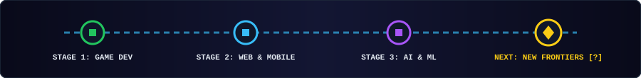

  

<h1 align="center">Christian Surya T. <kbd>@chris-s-t</kbd></h1>

  <b>Game Developer · Software Developer · Full-Stack Builder · AI Enthusiast</b> 
  <i>"I enjoy exploring new things and implementing them, innovating new ways from old ways for best efficiency."</i>

  
  

---

### 🧭 Current Quest Log

| Domain | Active Exploration & Focus |
| :--- | :--- |
| **🎮 Game Development** | Building 2D/3D mechanics, physics systems, and interactive worlds in **Unity** & **Roblox Studio** |
| **🧠 Machine Learning & AI** | Deep learning architectures, NLP tokenization, model evaluation, and Predictive Analytics |
| **🌐 Web & Mobile Systems** | Full-stack applications, local-first utilities, **React + Vite**, and **Android Jetpack Compose** |

---

### 🛠️ Skill Tree & Tech Inventory

| Category | Technologies & Tools |
| :--- | :--- |
| **Languages** |        |
| **Game & Mobile** |     |
| **Web & Backend** |     |
| **Databases** |     |
| **IDEs & Workstations** |       |
| **Systems & Docs** |      |

 

  
   
  Always unlocking new skill trees, Inovate and Improve Ways.

---

### 🗺️ A Few Side-Quests I'm Working Toward

- ⚔️ Designing deeper gameplay loops and custom physics systems in **Unity** & **Roblox**.
- 🤖 Experimenting with neural networks, multilingual NLP models, and applied **Machine Learning**.
- 🏡 Innovating apps and web platforms for Property Agencies and Financial Administration.
- ⚡ Building lightweight desktop & web utilities that solve everyday workflow friction.
- 🔎 Researching AI Automation and workflow efficiency in **n8n** & **9router**.

 